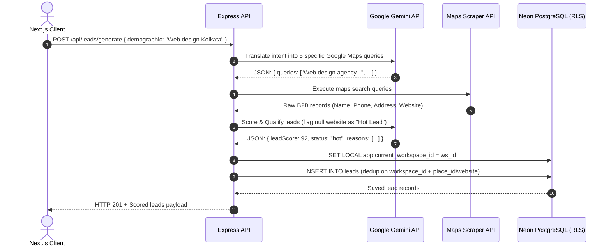
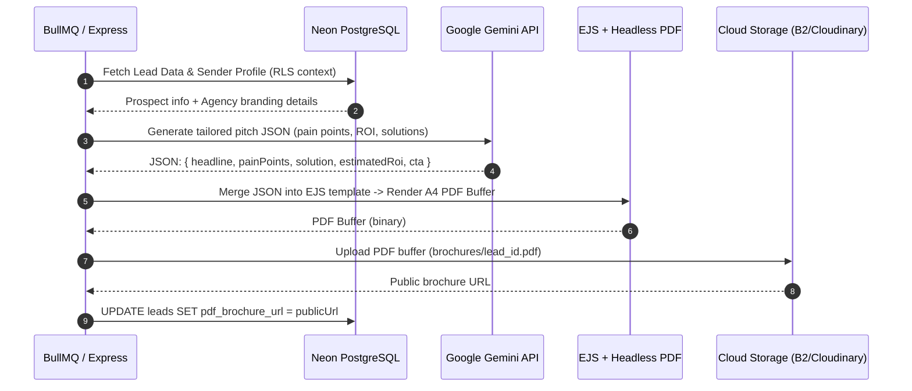
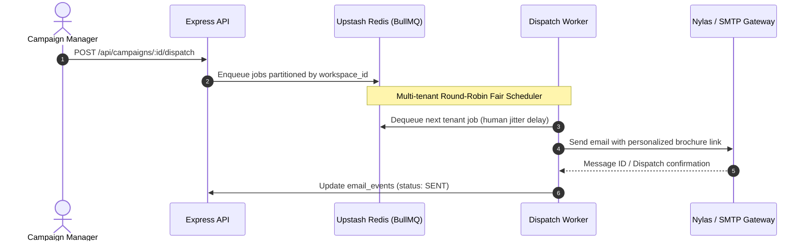
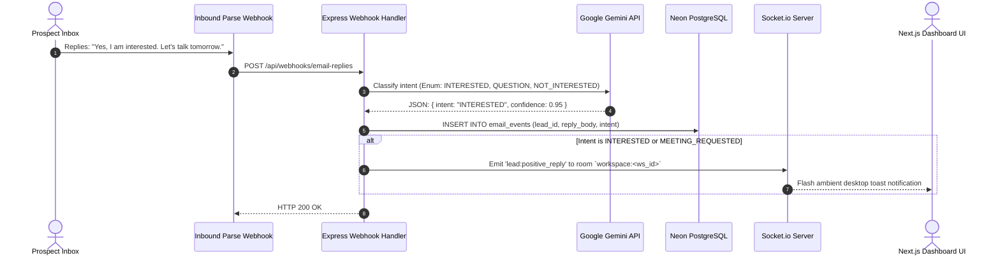
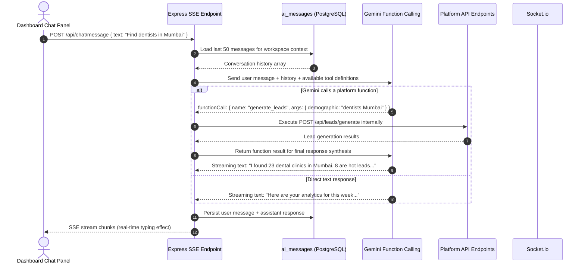
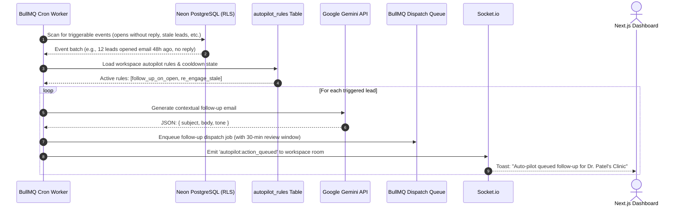
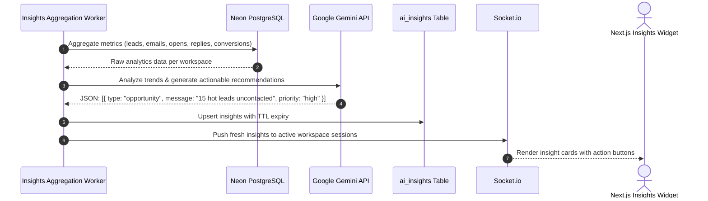

# System Architecture Document

## Document Information
- **System Name:** LeadPilot AI Platform Architecture
- **Version:** 1.0.0
- **Status:** Approved Baseline
- **Date:** October 13, 2026

---

## 1. High-Level Architectural Overview

LeadPilot AI is architected as an enterprise-grade, multi-tenant monorepo. It cleanly decouples client presentation, API orchestration, background queuing, distributed worker processing, and relational persistence.

```
                                  ┌──────────────────────────────────────────────┐
                                  │            Next.js App Router (UI)           │
                                  │       (Clerk Auth + Socket.io-client)        │
                                  └───────────────────────┬──────────────────────┘
                                                          │ HTTP REST / WebSocket
                                                          ▼
                                  ┌──────────────────────────────────────────────┐
                                  │           Express.js API Gateway             │
                                  │   (Tenant Middleware + Drizzle / Prisma)     │
                                  └───────────┬───────────────┬──────────────┬───┘
                                              │               │              │
                   ┌──────────────────────────┘               │              └────────────────────────┐
                   ▼                                          ▼                                       ▼
      ┌─────────────────────────┐               ┌──────────────────────────┐             ┌─────────────────────────┐
      │     Google Gemini API   │               │  PostgreSQL (Neon) RLS   │             │   Upstash Redis &       │
      │  (Structured Outputs)   │               │   Tenant Data Isolation  │             │   BullMQ Queues         │
      └─────────────────────────┘               │   (SET LOCAL ws_id)      │             │  (Fair-Share Workers)   │
                                                └──────────────────────────┘             └────────────┬────────────┘
                                                                                                      │
                                                                                                      ▼
                                                                                         ┌─────────────────────────┐
                                                                                         │  Outreach & Scraping    │
                                                                                         │  - Puppeteer / PDF API  │
                                                                                         │  - Backblaze B2 / Cloud │
                                                                                         │  - Nylas / SMTP Dispatch│
                                                                                         └─────────────────────────┘
```

---

## 2. Technology Stack

### 2.1 Frontend Client
- **Framework:** Next.js 15 (React 19, App Router)
- **Styling & Components:** Tailwind CSS, Shadcn UI / Radix Primitives, Lucide Icons
- **Authentication:** Clerk (Multi-tenant Organizations & Role-Based Access Control)
- **Real-Time Client:** `socket.io-client` (Room-based tenant subscriptions)
- **State & Data Fetching:** React Server Components (RSC) + TanStack Query

### 2.2 Backend API & Orchestration
- **Runtime & Server:** Node.js, Express.js, TypeScript (Strict Mode)
- **Real-Time Engine:** `socket.io` (Tenant room multiplexing `workspace:<id>`)
- **Validation:** Zod (Request bodies, query params, environment configs, AI JSON schemas)
- **Template Compilation:** EJS / Handlebars (Brochure HTML rendering)

### 2.3 Persistence & Multi-Tenancy
- **Database:** PostgreSQL on Neon Serverless with Row-Level Security (RLS)
- **Tenant Isolation Policy:** Every table contains `workspace_id`. Sessions execute `SET LOCAL app.current_workspace_id = :workspaceId`.
- **ORM / Query Builder:** Drizzle ORM (Zero-overhead, native Neon RLS support) / Prisma
- **Billing:** Stripe (Metered subscription tiers, usage-based credits)

### 2.4 Queuing, Caching & Workers
- **Message Broker:** Upstash Redis (Serverless Redis instance)
- **Queue Engine:** BullMQ
  - Multi-tenant Round-Robin fair scheduling
  - Human-like outbound rate limiting (configurable daily limits & send windows)
  - Automatic exponential backoff retries

### 2.5 External Integrations & AI Engine
- **AI Engine:** Google Gemini API (`gemini-2.5-flash` with structured outputs + function calling)
- **Data Scraping:** Google Maps Scraping API (Outscraper / SerpApi / Playwright)
- **PDF Generation:** Serverless Puppeteer / PDF API (Doppio / PDFBolt)
- **Cloud Storage:** Backblaze B2 / Cloudinary (Brochure PDF hosting)
- **Outbound / Inbound Email:** Nylas Universal Email API / Aurinko / Custom SMTP + Inbound Parse Webhooks

### 2.6 Built-In AI Native Layer
- **AI Command Center (Chat Assistant):**
  - Gemini with Function Calling / Tool Use for natural language → platform action mapping
  - Streaming responses via Server-Sent Events (SSE) for real-time chat UX
  - Per-workspace conversation history stored in PostgreSQL (`ai_conversations`, `ai_messages` tables)
  - Action confirmation cards rendered as structured UI components before destructive operations
- **AI Auto-Pilot Engine:**
  - BullMQ scheduled/cron workers for autonomous follow-up sequences, re-engagement, and send-time optimization
  - `autopilot_rules` table stores per-workspace automation configurations (trigger conditions, actions, cooldowns)
  - Event-driven architecture: email opens, replies, and bounces trigger rule evaluation via Redis pub/sub
- **AI Insights & Recommendations:**
  - Background analytics aggregation worker (runs every 6 hours or on significant data events)
  - `ai_insights` table caches proactive recommendations with expiry timestamps
  - Real-time insight delivery via Socket.io push to active dashboard sessions
- **AI Email Composer:**
  - Streaming Gemini responses for real-time text generation in the email editor
  - A/B variant generation with predicted open-rate scoring
  - Spam/deliverability analysis via rule-based + AI hybrid scoring engine
  - Tone control parameter passed to Gemini system prompt (Professional / Casual / Urgent / Friendly)

---

## 3. Monorepo Directory Tree

```
automated-leads-generator/
├── prd.md                                # Product Requirements Document
├── architecture.md                       # System Architecture (this document)
├── rules.md                              # Development Rules & Coding Standards
├── design.md                             # UI/UX Design System Specifications
├── task.md                               # Phase 1 Execution Roadmap
├── memory.md                             # Project Memory & Feature State Registry
├── package.json                          # Root monorepo workspace configuration
├── .gitignore
├── apps/                                 # Production monorepo apps
│   ├── web/                              # Next.js Frontend Application
│   │   ├── package.json
│   │   ├── tsconfig.json
│   │   ├── tailwind.config.ts
│   │   └── src/
│   │       ├── app/                      # Next.js App Router (dashboard, campaigns, leads)
│   │       ├── components/               # Shadcn UI & custom presentation components
│   │       │   ├── table/                # Interactive Lead Data Table
│   │       │   ├── brochure/             # PDF Template Previewer
│   │       │   └── notifications/        # Live Socket Toast Listeners
│   │       └── lib/                      # Client-side API wrappers & Socket singletons
│   └── api/                              # Express.js Backend API Server
│       ├── package.json
│       ├── tsconfig.json
│       └── src/
│           ├── config/                   # Singletons (env, db, redis, gemini)
│           ├── db/                       # PostgreSQL schema.sql & Drizzle schema.ts
│           ├── middleware/               # Tenant RLS, Auth, Zod Validation, Error handler
│           ├── routes/                   # Domain routes (leads, ai, campaigns, webhooks, chat)
│           │   └── chat.routes.ts        # AI Command Center SSE streaming endpoints
│           ├── services/                 # GeminiService, BrochureService, QueueService, SocketService
│           │   ├── ai-chat.service.ts    # Conversation memory + Gemini function calling orchestrator
│           │   ├── ai-autopilot.service.ts # Autonomous workflow rule engine
│           │   ├── ai-insights.service.ts  # Analytics aggregation & recommendation generator
│           │   └── ai-composer.service.ts  # Email generation, A/B testing, deliverability scoring
│           ├── workers/                  # BullMQ background processors
│           │   ├── dispatch.worker.ts    # Email dispatch with human-like pacing
│           │   ├── autopilot.worker.ts   # Autonomous follow-up & re-engagement cron worker
│           │   └── insights.worker.ts    # Periodic analytics aggregation worker
│           └── server.ts                 # Express + HTTP + Socket.io entrypoint
└── packages/                             # Shared packages
    ├── database/                         # Shared DB connection & migrations
    └── shared-types/                     # Shared TypeScript domain contracts & Zod schemas
```

---

## 4. End-to-End Data Flow Diagrams

### 4.1 Pipeline 1: AI-Scraper-AI Lead Discovery & Qualification



### 4.2 Pipeline 2: Dynamic PDF Brochure Synthesis



### 4.3 Pipeline 3: Fair-Share Queue Dispatch



### 4.4 Pipeline 4: Inbound Webhook Triage & Real-Time Alert Loop



### 4.5 Pipeline 5: AI Command Center (Chat Assistant)



### 4.6 Pipeline 6: AI Auto-Pilot Workflow Engine



### 4.7 Pipeline 7: AI Insights & Recommendations


